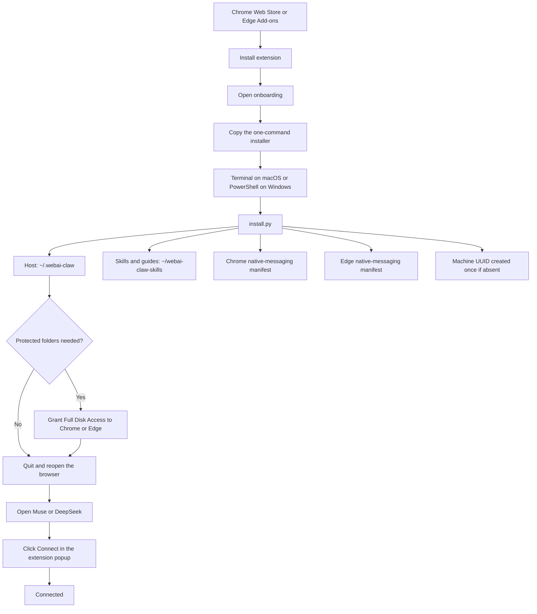
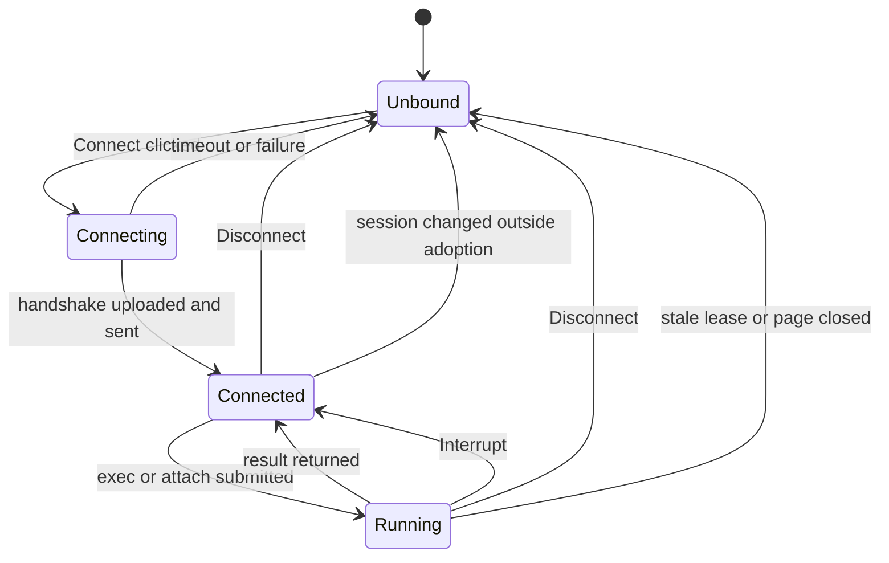
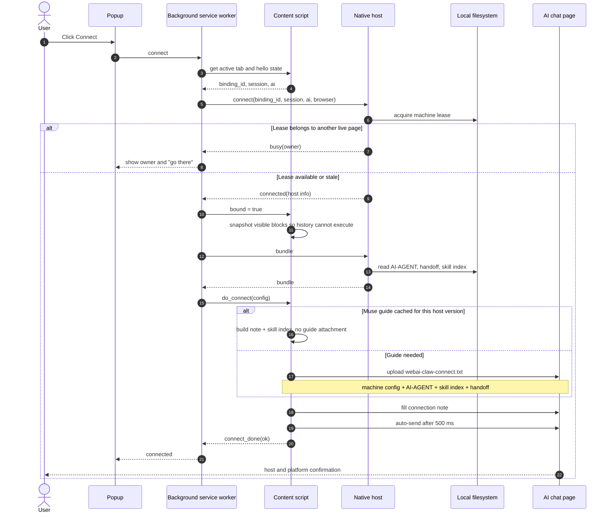
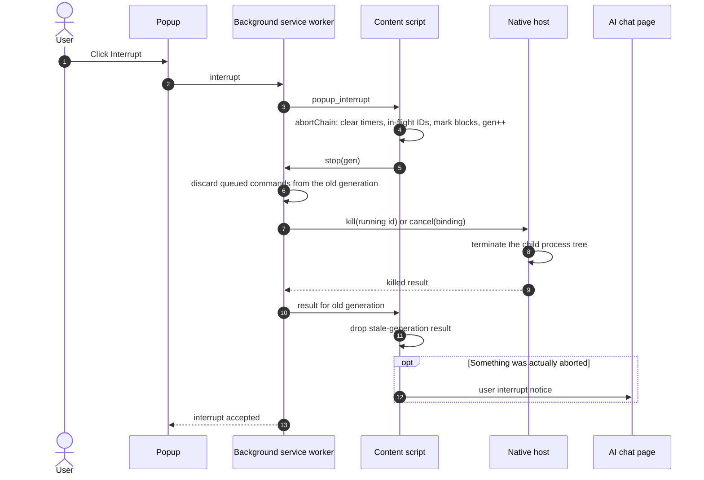
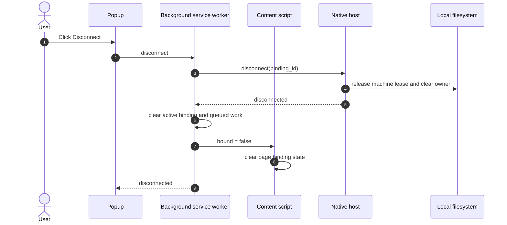
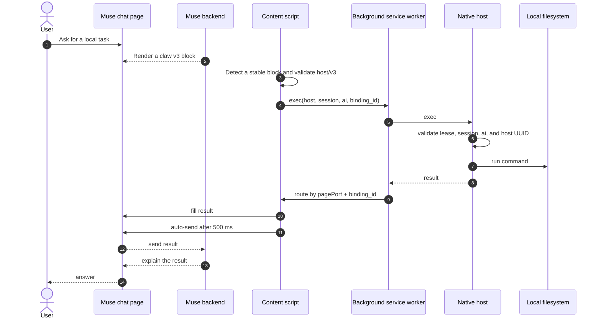
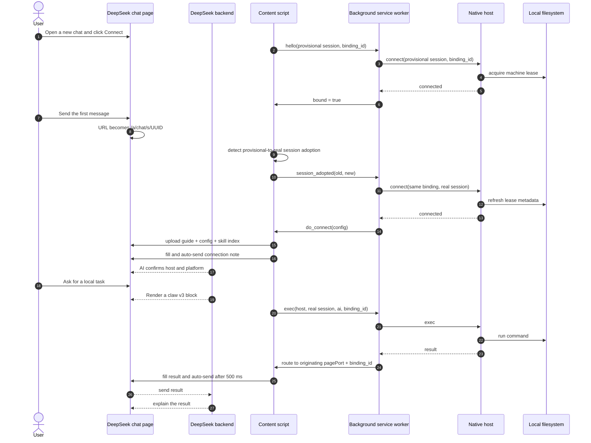
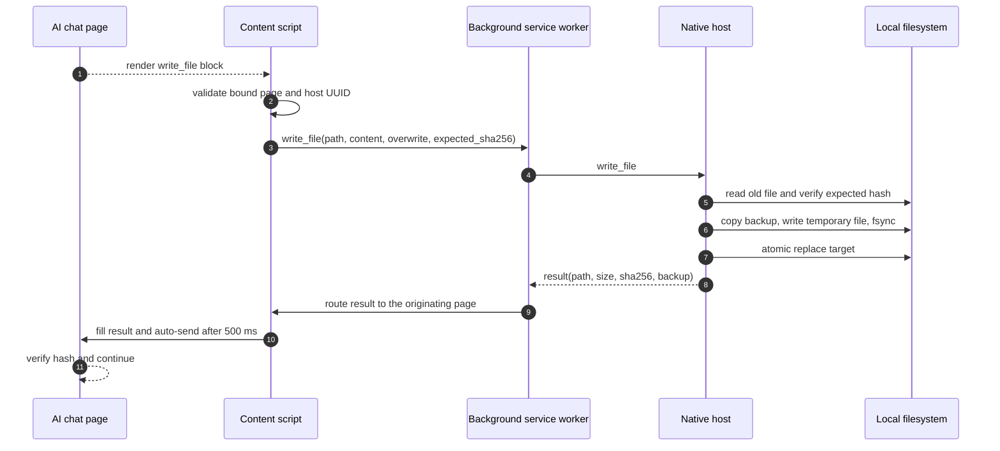

# webai-claw interaction diagrams

These diagrams use **Mermaid**. GitHub renders Mermaid blocks directly. They
also work in VS Code (Mermaid extension) and <https://mermaid.live>.

The diagrams describe the intended 1.2 flow. Installation still uses the
one-command native-host installer; the extension remains the browser half.

## 1. Installation

## 2. Connection state

`Interrupt` aborts the current chain and kills the running host command, but
keeps the page bound. `Disconnect` releases the machine binding.

## 3. Connect

## 4. Interrupt

## 5. Disconnect

## 6. Muse through the extension and native host

Muse can use a thread URL such as `https://muse.ai/thread/<uuid>` or the main
chat at `https://muse.ai`. The main chat has no unique thread ID, so the page
`binding_id` and background `pagePort` provide uniqueness.

Muse guide behavior:

- The first Connect for a host version uploads `AI-AGENT.md`.
- Later Connects reuse the guide from Muse conversation memory.
- The skill index is still delivered, in the Connect note if no attachment is
  needed.
- A host upgrade changes the host version and causes the guide to be sent again.

## 7. DeepSeek through the extension and native host

DeepSeek may start with a provisional session such as
`https://chat.deepseek.com`, then adopt the real
`https://chat.deepseek.com/a/chat/s/<uuid>` after the first message. The same
binding is retained; the user does not need to reconnect.

DeepSeek sends the guide on Connect rather than relying on long-lived memory.
The machine binding is still tied to the page, not to the URL alone.

## 8. File write

`write_file` is not a shell redirect. It uses a same-directory temporary file,
atomic replacement, optional hash validation, and a backup by default.
